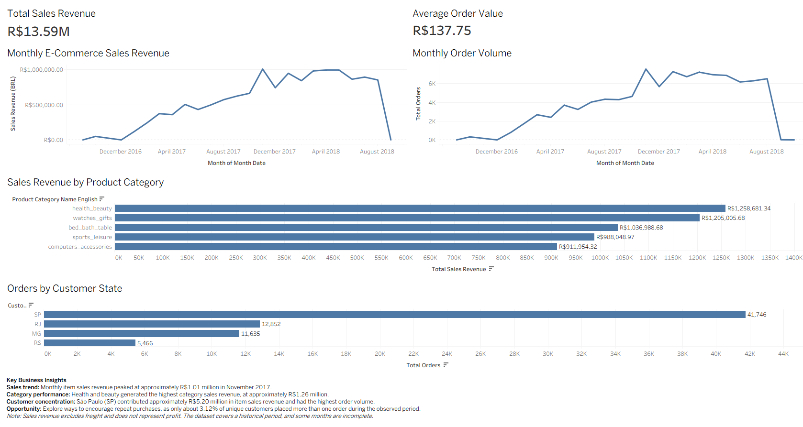
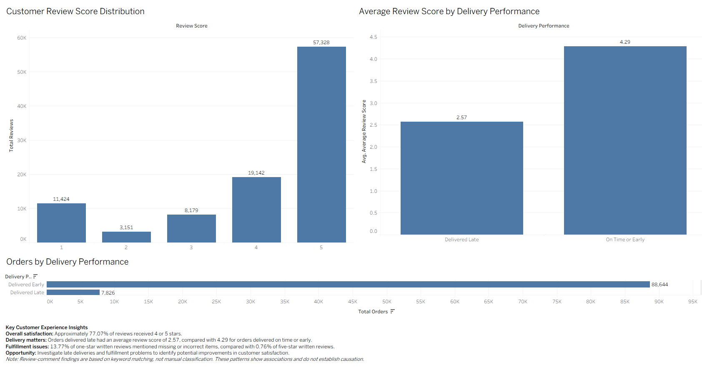

# Olist E-Commerce Data Analytics Project

## Project Overview

This project analyzes the Brazilian e-commerce dataset from Olist to identify trends in sales performance, customer behavior, product categories, delivery performance, and customer satisfaction.

The goal is to turn raw e-commerce data into actionable business insights using Python, SQL, and Tableau.

## Tools and Technologies

- **Python:** Data cleaning, exploratory data analysis, and review-comment analysis
- **Pandas:** Data manipulation and analysis
- **Matplotlib:** Data visualization
- **SQL Server:** Business analysis and data aggregation
- **Tableau Public:** Interactive dashboards and data storytelling
- **Jupyter Notebook:** Analysis documentation

## Business Questions

1. How do sales revenue and order volume change over time?
2. Which product categories generate the highest sales?
3. Which Brazilian states contribute the most orders and revenue?
4. Which payment methods are most commonly used?
5. How does delivery performance relate to customer satisfaction?
6. What issues appear most frequently in low-rated written reviews?
7. What opportunities exist to improve customer retention and fulfillment?

## Key Findings

- **Sales performance:** Monthly item sales revenue peaked at approximately R$1.01 million in November 2017.
- **Product categories:** Health and beauty generated approximately R$1.26 million in item sales revenue.
- **Customer geography:** São Paulo accounted for approximately R$5.20 million in item sales revenue and had the highest order volume.
- **Customer satisfaction:** Approximately 77.07% of reviews received four or five stars.
- **Delivery performance:** Orders delivered late had an average review score of 2.57, compared with 4.29 for orders delivered on time or early.
- **Fulfillment issues:** Keywords related to missing or incorrect items appeared in 13.77% of one-star written reviews, compared with 0.76% of five-star written reviews.
- **Customer retention:** Approximately 3.12% of unique customers placed more than one order during the observed period.

## Methodology

1. Inspected and cleaned the source datasets using Python and Pandas.
2. Exported processed datasets for SQL analysis.
3. Loaded the datasets into Microsoft SQL Server.
4. Wrote SQL queries to analyze sales, order status, customer geography, payment methods, delivery performance, and reviews.
5. Used Python to explore review comments through word frequencies and keyword-based theme analysis.
6. Built Tableau dashboards to communicate business findings.

## Dashboards

### Sales Overview

This dashboard summarizes overall sales performance, monthly sales and order trends, product category revenue, and customer geography.

### Customer Experience

This dashboard explores review score distribution, delivery performance, and the relationship between delivery timing and customer satisfaction.

*Note: The images above are static screenshots. Interactive dashboards will be linked here after publication.*

## Project Structure

- `data/raw/` — Original source datasets
- `data/processed/` — Cleaned datasets and SQL analysis outputs
- `notebooks/` — Python data exploration and review-comment analysis
- `sql/` — SQL analysis queries
- `visualizations/` — Charts generated during Python analysis
- `README.md` — Project documentation

## Limitations

- The dataset covers a historical period, and the final months are incomplete.
- Sales figures generally represent item prices and exclude freight; they are not measures of profit.
- Delivery and review patterns show associations, not proof of causation.
- Review-comment themes are identified through keyword matching rather than manual classification.
- The observed repeat-purchase rate reflects the available dataset period and may not represent long-term customer retention.

## Dataset

Source: [Brazilian E-Commerce Public Dataset by Olist on Kaggle](https://www.kaggle.com/datasets/olistbr/brazilian-ecommerce)

## Author

**Jhove Batarao**

Computer Engineering graduate exploring data analytics, software quality assurance, and data-driven problem solving.